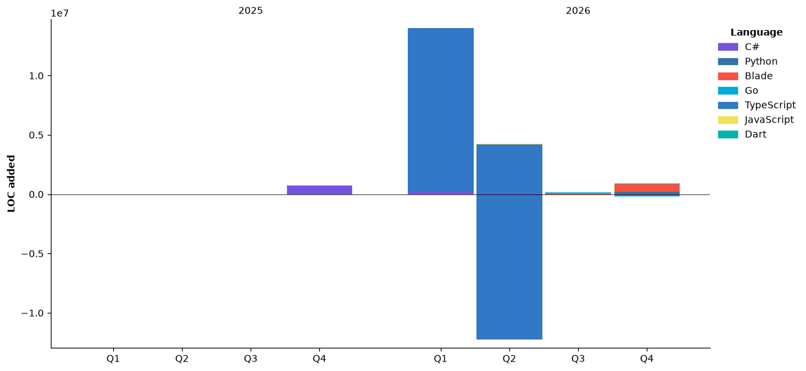

# Hi 👋, I'm Phan Khánh Duy
Welcome to my GitHud account

I'm web developer </br>
I have an interest in designing and developing interfaces and frontend </br>
My hoppies is playing football, photography and coding

- ⚡ Fun fact **I am a humorous guy and find it very easy to get along with others.**

<h3 align="center">A passionate web developer from VietNam</h3>


## 🌐Socials
[](https://facebook.com/https://www.facebook.com/share/1ScmEXBRy1/) [](https://instagram.com/https://l.facebook.com/l.php?u=https%3A%2F%2Fwww.instagram.com%2Fphankdzi_21.12%3Figsh%3DMW9pYm45MWd5ZzYyeg%253D%253D%26fbclid%3DIwZXh0bgNhZW0CMTAAYnJpZBEwbGJ1azI2SWxtYXZrQnYyagEe8Tk40nAna28M7q3zKT7WB5WwKJTxCwVJ6z0wnx0kTHOJM8zVvQVVtbFQHE8_aem_kSKeyMxJPhs8rfYBsZaRrA&h=AT11ZnOCp9PR_8nWmbjK2T25j6ecpu8RBWEkuGeImoCQ6pDK288LJziOnakYRdwggLSpztmnYPcBkPGfoiKyaavtX9uh5GJ2ha8tiDE2v1vHWNDSbJkxWqv00VyLPraebnBAYji5q6auWHEK8wbSgg) [](https://pinterest.com/https://l.facebook.com/l.php?u=https%3A%2F%2Fpin.it%2FkUcZw5x8Z%3Ffbclid%3DIwZXh0bgNhZW0CMTAAYnJpZBEwbGJ1azI2SWxtYXZrQnYyagEeL-8SAJd7iCqncT9jesB4a_L72TMJclg8BfcYy5m3GkA0sG57UhQ33xPHGC0_aem_sGncqwV3XROjeLNW9F058A&h=AT35ZrLWXGd2sI5lKInoCkqDJj-NybDV8obEKmcZEOfyVVRs6HuuR5UwgdQo1k1RJ5_LFqDbZkW1vBzXZAizo7JlqshGrYWRMP8L2JlM94CpFag35IXimll_e64iisZGHSb_VZ8n-qFxBti_RAPyJg) 

# 💻Tech Stack
<h3 align="left">Languages and Tools:</h3>
<p align="left"> <a href="https://developer.mozilla.org/en-US/docs/Web/bootstrap" target="_blank" rel="noreferrer">  </a> <a href="https://developer.mozilla.org/en-US/docs/Web/css3" target="_blank" rel="noreferrer">  </a> <a href="https://developer.mozilla.org/en-US/docs/Web/docker" target="_blank" rel="noreferrer">  </a> <a href="https://developer.mozilla.org/en-US/docs/Web/express" target="_blank" rel="noreferrer">  </a> <a href="https://developer.mozilla.org/en-US/docs/Web/figma" target="_blank" rel="noreferrer">  </a> <a href="https://developer.mozilla.org/en-US/docs/Web/flutter" target="_blank" rel="noreferrer">  </a> <a href="https://developer.mozilla.org/en-US/docs/Web/html5" target="_blank" rel="noreferrer">  </a> <a href="https://developer.mozilla.org/en-US/docs/Web/illustrator" target="_blank" rel="noreferrer">  </a> <a href="https://developer.mozilla.org/en-US/docs/Web/java" target="_blank" rel="noreferrer">  </a> <a href="https://developer.mozilla.org/en-US/docs/Web/javascript" target="_blank" rel="noreferrer">  </a> <a href="https://developer.mozilla.org/en-US/docs/Web/laravel" target="_blank" rel="noreferrer">  </a> <a href="https://developer.mozilla.org/en-US/docs/Web/mysql" target="_blank" rel="noreferrer">  </a> <a href="https://developer.mozilla.org/en-US/docs/Web/nestjs" target="_blank" rel="noreferrer">  </a> <a href="https://developer.mozilla.org/en-US/docs/Web/nodejs" target="_blank" rel="noreferrer">  </a> <a href="https://developer.mozilla.org/en-US/docs/Web/photoshop" target="_blank" rel="noreferrer">  </a> <a href="https://developer.mozilla.org/en-US/docs/Web/php" target="_blank" rel="noreferrer">  </a> <a href="https://developer.mozilla.org/en-US/docs/Web/postgresql" target="_blank" rel="noreferrer">  </a> <a href="https://developer.mozilla.org/en-US/docs/Web/postman" target="_blank" rel="noreferrer">  </a> <a href="https://developer.mozilla.org/en-US/docs/Web/react" target="_blank" rel="noreferrer">  </a> <a href="https://developer.mozilla.org/en-US/docs/Web/tailwind" target="_blank" rel="noreferrer">  </a> <a href="https://developer.mozilla.org/en-US/docs/Web/typescript" target="_blank" rel="noreferrer">  </a></p>


# 📊GitHub Stats :
<br/>
<br/>


## 🏆GitHub Trophies


### ✍️Random Dev Quote


<!--START_SECTION:waka-->


**🐱 My GitHub Data** 

> 📦 127.9 kB Used in GitHub's Storage 
 > 
> 🏆 408 Contributions in the Year 2026
 > 
> 🚫 Not Opted to Hire
 > 
> 📜 11 Public Repositories 
 > 
> 🔑 0 Private Repositories 
 > 
**I'm a Night 🦉** 

```text
🌞 Morning                385 commits         ███████░░░░░░░░░░░░░░░░░░   29.03 % 
🌆 Daytime                94 commits          ██░░░░░░░░░░░░░░░░░░░░░░░   07.09 % 
🌃 Evening                175 commits         ███░░░░░░░░░░░░░░░░░░░░░░   13.20 % 
🌙 Night                  672 commits         █████████████░░░░░░░░░░░░   50.68 % 
```
📅 **I'm Most Productive on Tuesday** 

```text
Monday                   193 commits         ████░░░░░░░░░░░░░░░░░░░░░   14.56 % 
Tuesday                  261 commits         █████░░░░░░░░░░░░░░░░░░░░   19.68 % 
Wednesday                213 commits         ████░░░░░░░░░░░░░░░░░░░░░   16.06 % 
Thursday                 135 commits         ███░░░░░░░░░░░░░░░░░░░░░░   10.18 % 
Friday                   197 commits         ████░░░░░░░░░░░░░░░░░░░░░   14.86 % 
Saturday                 138 commits         ███░░░░░░░░░░░░░░░░░░░░░░   10.41 % 
Sunday                   189 commits         ████░░░░░░░░░░░░░░░░░░░░░   14.25 % 
```


📊 **This Week I Spent My Time On** 

```text
🕑︎ Time Zone: America/Denver

💬 Programming Languages: 
TypeScript               7 hrs 7 mins        ████████████████░░░░░░░░░   65.58 % 
PHP                      1 hr 51 mins        ████░░░░░░░░░░░░░░░░░░░░░   17.15 % 
Markdown                 33 mins             █░░░░░░░░░░░░░░░░░░░░░░░░   05.13 % 
Bash                     32 mins             █░░░░░░░░░░░░░░░░░░░░░░░░   05.00 % 
Blade Template           29 mins             █░░░░░░░░░░░░░░░░░░░░░░░░   04.47 % 

🔥 Editors: 
VS Code                  6 hrs 23 mins       ███████████████░░░░░░░░░░   58.81 % 
Antigravity IDE          2 hrs 30 mins       ██████░░░░░░░░░░░░░░░░░░░   23.02 % 
Copilot CLI              1 hr 29 mins        ███░░░░░░░░░░░░░░░░░░░░░░   13.67 % 
Antigravity Desktop      28 mins             █░░░░░░░░░░░░░░░░░░░░░░░░   04.41 % 
Copilot                  0 secs              ░░░░░░░░░░░░░░░░░░░░░░░░░   00.10 % 

🐱‍💻 Projects: 
university-recruitment-cr7 hrs 55 mins       ██████████████████░░░░░░░   73.01 % 
AGU-Academic-Hub         1 hr 38 mins        ████░░░░░░░░░░░░░░░░░░░░░   15.15 % 
larashop                 1 hr 8 mins         ███░░░░░░░░░░░░░░░░░░░░░░   10.52 % 
lung-lesion-segmentation 8 mins              ░░░░░░░░░░░░░░░░░░░░░░░░░   01.31 % 

💻 Operating System: 
Windows                  10 hrs 51 mins      █████████████████████████   100.00 % 
```

🤖 **AI Coding This Week** 

```text
⏱ AI Coding Time: 3 hrs 24 mins (31.33%)

✍️ 765 lines written by AI, 2,671 lines written by hand (22.26% AI-written)

🔤 1,234,118 Input Tokens, 453,517 Output Tokens

💵 $15.65 Estimated AI Cost This Week

🧠 7 AI Sessions, 33 AI Prompts

GPT                      1,061 lines         ████████████████████████░   95.24 % 
Gemini                   53 lines            █░░░░░░░░░░░░░░░░░░░░░░░░   04.76 % 
Sonnet                   0 lines             ░░░░░░░░░░░░░░░░░░░░░░░░░   00.00 % 

🔎 AI Coding Insights:
🧑‍💻 Mostly Hands-On — 22.26% of written lines came from AI
📝 Concise Prompter — average 438 characters per prompt
🔁 Iterative Prompter — average 5 prompts per session
🔍 Hands-On Reviewer — 79.55% of changed lines were hand-edited
```

**I Mostly Code in TypeScript** 

```text
TypeScript               6 repos             █████████░░░░░░░░░░░░░░░░   35.29 % 
Python                   4 repos             ██████░░░░░░░░░░░░░░░░░░░   23.53 % 
C#                       3 repos             ████░░░░░░░░░░░░░░░░░░░░░   17.65 % 
Blade                    1 repo              █░░░░░░░░░░░░░░░░░░░░░░░░   05.88 % 
Go                       1 repo              █░░░░░░░░░░░░░░░░░░░░░░░░   05.88 % 
```


**Timeline**




 Last Updated on 17/11/2026 05:28:43 UTC
<!--END_SECTION:waka-->

