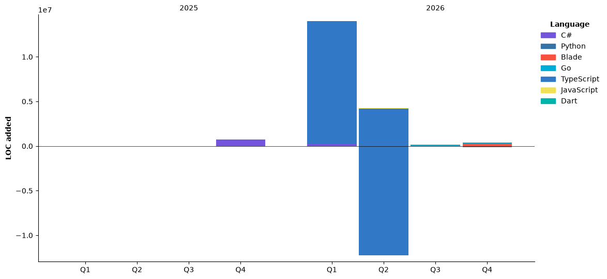

# Hi 👋, I'm Phan Khánh Duy
Welcome to my GitHud account

I'm web developer </br>
I have an interest in designing and developing interfaces and frontend </br>
My hoppies is playing football, photography and coding

- ⚡ Fun fact **I am a humorous guy and find it very easy to get along with others.**

<h3 align="center">A passionate web developer from VietNam</h3>


## 🌐Socials
[](https://facebook.com/https://www.facebook.com/share/1ScmEXBRy1/) [](https://instagram.com/https://l.facebook.com/l.php?u=https%3A%2F%2Fwww.instagram.com%2Fphankdzi_21.12%3Figsh%3DMW9pYm45MWd5ZzYyeg%253D%253D%26fbclid%3DIwZXh0bgNhZW0CMTAAYnJpZBEwbGJ1azI2SWxtYXZrQnYyagEe8Tk40nAna28M7q3zKT7WB5WwKJTxCwVJ6z0wnx0kTHOJM8zVvQVVtbFQHE8_aem_kSKeyMxJPhs8rfYBsZaRrA&h=AT11ZnOCp9PR_8nWmbjK2T25j6ecpu8RBWEkuGeImoCQ6pDK288LJziOnakYRdwggLSpztmnYPcBkPGfoiKyaavtX9uh5GJ2ha8tiDE2v1vHWNDSbJkxWqv00VyLPraebnBAYji5q6auWHEK8wbSgg) [](https://pinterest.com/https://l.facebook.com/l.php?u=https%3A%2F%2Fpin.it%2FkUcZw5x8Z%3Ffbclid%3DIwZXh0bgNhZW0CMTAAYnJpZBEwbGJ1azI2SWxtYXZrQnYyagEeL-8SAJd7iCqncT9jesB4a_L72TMJclg8BfcYy5m3GkA0sG57UhQ33xPHGC0_aem_sGncqwV3XROjeLNW9F058A&h=AT35ZrLWXGd2sI5lKInoCkqDJj-NybDV8obEKmcZEOfyVVRs6HuuR5UwgdQo1k1RJ5_LFqDbZkW1vBzXZAizo7JlqshGrYWRMP8L2JlM94CpFag35IXimll_e64iisZGHSb_VZ8n-qFxBti_RAPyJg) 

# 💻Tech Stack
<h3 align="left">Languages and Tools:</h3>
<p align="left"> <a href="https://developer.mozilla.org/en-US/docs/Web/bootstrap" target="_blank" rel="noreferrer">  </a> <a href="https://developer.mozilla.org/en-US/docs/Web/css3" target="_blank" rel="noreferrer">  </a> <a href="https://developer.mozilla.org/en-US/docs/Web/docker" target="_blank" rel="noreferrer">  </a> <a href="https://developer.mozilla.org/en-US/docs/Web/express" target="_blank" rel="noreferrer">  </a> <a href="https://developer.mozilla.org/en-US/docs/Web/figma" target="_blank" rel="noreferrer">  </a> <a href="https://developer.mozilla.org/en-US/docs/Web/flutter" target="_blank" rel="noreferrer">  </a> <a href="https://developer.mozilla.org/en-US/docs/Web/html5" target="_blank" rel="noreferrer">  </a> <a href="https://developer.mozilla.org/en-US/docs/Web/illustrator" target="_blank" rel="noreferrer">  </a> <a href="https://developer.mozilla.org/en-US/docs/Web/java" target="_blank" rel="noreferrer">  </a> <a href="https://developer.mozilla.org/en-US/docs/Web/javascript" target="_blank" rel="noreferrer">  </a> <a href="https://developer.mozilla.org/en-US/docs/Web/laravel" target="_blank" rel="noreferrer">  </a> <a href="https://developer.mozilla.org/en-US/docs/Web/mysql" target="_blank" rel="noreferrer">  </a> <a href="https://developer.mozilla.org/en-US/docs/Web/nestjs" target="_blank" rel="noreferrer">  </a> <a href="https://developer.mozilla.org/en-US/docs/Web/nodejs" target="_blank" rel="noreferrer">  </a> <a href="https://developer.mozilla.org/en-US/docs/Web/photoshop" target="_blank" rel="noreferrer">  </a> <a href="https://developer.mozilla.org/en-US/docs/Web/php" target="_blank" rel="noreferrer">  </a> <a href="https://developer.mozilla.org/en-US/docs/Web/postgresql" target="_blank" rel="noreferrer">  </a> <a href="https://developer.mozilla.org/en-US/docs/Web/postman" target="_blank" rel="noreferrer">  </a> <a href="https://developer.mozilla.org/en-US/docs/Web/react" target="_blank" rel="noreferrer">  </a> <a href="https://developer.mozilla.org/en-US/docs/Web/tailwind" target="_blank" rel="noreferrer">  </a> <a href="https://developer.mozilla.org/en-US/docs/Web/typescript" target="_blank" rel="noreferrer">  </a></p>


# 📊GitHub Stats :
<br/>
<br/>


## 🏆GitHub Trophies


### ✍️Random Dev Quote


<!--START_SECTION:waka-->


**🐱 My GitHub Data** 

> 📦 127.3 kB Used in GitHub's Storage 
 > 
> 🏆 397 Contributions in the Year 2026
 > 
> 🚫 Not Opted to Hire
 > 
> 📜 11 Public Repositories 
 > 
> 🔑 0 Private Repositories 
 > 
**I'm a Night 🦉** 

```text
🌞 Morning                381 commits         ███████░░░░░░░░░░░░░░░░░░   28.89 % 
🌆 Daytime                94 commits          ██░░░░░░░░░░░░░░░░░░░░░░░   07.13 % 
🌃 Evening                175 commits         ███░░░░░░░░░░░░░░░░░░░░░░   13.27 % 
🌙 Night                  669 commits         █████████████░░░░░░░░░░░░   50.72 % 
```
📅 **I'm Most Productive on Tuesday** 

```text
Monday                   193 commits         ████░░░░░░░░░░░░░░░░░░░░░   14.63 % 
Tuesday                  261 commits         █████░░░░░░░░░░░░░░░░░░░░   19.79 % 
Wednesday                214 commits         ████░░░░░░░░░░░░░░░░░░░░░   16.22 % 
Thursday                 135 commits         ███░░░░░░░░░░░░░░░░░░░░░░   10.24 % 
Friday                   193 commits         ████░░░░░░░░░░░░░░░░░░░░░   14.63 % 
Saturday                 131 commits         ██░░░░░░░░░░░░░░░░░░░░░░░   09.93 % 
Sunday                   192 commits         ████░░░░░░░░░░░░░░░░░░░░░   14.56 % 
```


📊 **This Week I Spent My Time On** 

```text
🕑︎ Time Zone: America/Denver

💬 Programming Languages: 
PHP                      4 hrs 36 mins       ██████████░░░░░░░░░░░░░░░   41.06 % 
TypeScript               3 hrs 31 mins       ████████░░░░░░░░░░░░░░░░░   31.40 % 
Markdown                 56 mins             ██░░░░░░░░░░░░░░░░░░░░░░░   08.44 % 
Python                   43 mins             ██░░░░░░░░░░░░░░░░░░░░░░░   06.50 % 
JavaScript               30 mins             █░░░░░░░░░░░░░░░░░░░░░░░░   04.56 % 

🔥 Editors: 
Antigravity IDE          4 hrs 44 mins       ███████████░░░░░░░░░░░░░░   42.26 % 
VS Code                  3 hrs 32 mins       ████████░░░░░░░░░░░░░░░░░   31.51 % 
Antigravity Desktop      1 hr 54 mins        ████░░░░░░░░░░░░░░░░░░░░░   16.95 % 
Copilot CLI              38 mins             █░░░░░░░░░░░░░░░░░░░░░░░░   05.65 % 
Antigravity              24 mins             █░░░░░░░░░░░░░░░░░░░░░░░░   03.63 % 

🐱‍💻 Projects: 
AGU-Academic-Hub         5 hrs 39 mins       █████████████░░░░░░░░░░░░   50.40 % 
university-recruitment-cr4 hrs 1 min         █████████░░░░░░░░░░░░░░░░   35.83 % 
TriTueNhanTao            28 mins             █░░░░░░░░░░░░░░░░░░░░░░░░   04.28 % 
larashop                 28 mins             █░░░░░░░░░░░░░░░░░░░░░░░░   04.25 % 
lung-lesion-segmentation 17 mins             █░░░░░░░░░░░░░░░░░░░░░░░░   02.56 % 

💻 Operating System: 
Windows                  11 hrs 14 mins      █████████████████████████   100.00 % 
```

🤖 **AI Coding This Week** 

```text
⏱ AI Coding Time: 6 hrs 10 mins (55.01%)

✍️ 0 lines written by AI, 1,562 lines written by hand (0.0% AI-written)

🔤 773,083 Input Tokens, 31,404 Output Tokens

💵 $15.41 Estimated AI Cost This Week

🧠 13 AI Sessions, 106 AI Prompts

GPT                      277 lines           █████████████████████░░░░   83.94 % 
Gemini                   53 lines            ████░░░░░░░░░░░░░░░░░░░░░   16.06 % 
Sonnet                   0 lines             ░░░░░░░░░░░░░░░░░░░░░░░░░   00.00 % 

🔎 AI Coding Insights:
🧑‍💻 Mostly Hands-On — 0.0% of written lines came from AI
📝 Concise Prompter — average 386 characters per prompt
🔁 Iterative Prompter — average 8 prompts per session
🔍 Hands-On Reviewer — 100.0% of changed lines were hand-edited
```

**I Mostly Code in TypeScript** 

```text
TypeScript               6 repos             █████████░░░░░░░░░░░░░░░░   35.29 % 
Python                   4 repos             ██████░░░░░░░░░░░░░░░░░░░   23.53 % 
C#                       3 repos             ████░░░░░░░░░░░░░░░░░░░░░   17.65 % 
Blade                    1 repo              █░░░░░░░░░░░░░░░░░░░░░░░░   05.88 % 
Go                       1 repo              █░░░░░░░░░░░░░░░░░░░░░░░░   05.88 % 
```


**Timeline**




 Last Updated on 13/11/2026 03:51:53 UTC
<!--END_SECTION:waka-->

